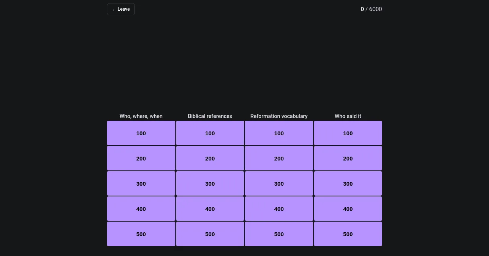
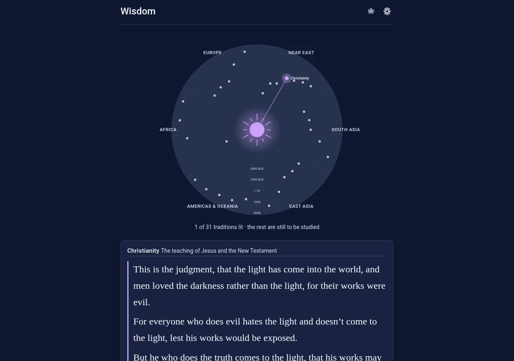

# Study: features

## The drill

A plain, honor-system pass through a set's questions: the card flips, you
self-grade "got it" or "missed it," a missed card goes to the back of the
queue and comes round again, and the pass ends when the queue is empty.
There is no text entry and nothing checks your answer. The whole set is
fetched once on entry — every fact already expanded into every question it
can be asked as — so nothing touches the network between flips. Swipe
right or left to grade, tap to flip; on a keyboard, space flips and the
arrow keys grade. A missed bookmark survives a locked phone: it is written
to the device on every grade and flushed to the server on a debounce, on
`visibilitychange` and `pagehide`.

## The board

A Jeopardy-style grid, offered only once enough of a set's facts are tagged
for one (`attrs.board` on a fact; a plain flashcard set has no board and
isn't offered one).

A column is every question that asks the same kind of
slot ("Name that year" is every `when`). A row is a rank among that
column's questions, decided by each question's current difficulty rating,
so a question you've been getting right slides down the board on its own
the next time it's dealt. A board is dealt once per session and never
re-sorted mid-game, so a tile never moves out from under a thumb already
headed for it. At least one column is guaranteed to be an "explain it"
column when the set has one, so a board of pure names-and-years can't be
won on recognition alone.

## A set is a file

`GET /study/api/sets/:id/file` returns a set as a bare JSON document — no
success envelope, no derived fields — and that same document is a valid
`PUT` body exactly as it comes back, fact ids included. Only `title` and
`facts` are required to import one, so an import that never mentions
`published` cannot accidentally unshare a set. A fact that keeps the id it
was exported with keeps the rating history and attempts recorded against
it; dropping the id silently discards everything the set has learned
about that fact. A response's `variants` (each declared question,
resolved, with a stable key) are computed on the server only; a client that
tries to derive its own will eventually disagree with it.

## Handing a set to an agent

Opening a set and pressing **Copy JSON** puts the file on the clipboard with
a short brief in front of it (`src/agentBrief.ts`) explaining the slot
vocabulary and the fact-id rule above; **Export file** is the same content
with no brief, as a download. Pasting a result back into **Import a file**
or **Paste a list** runs it through a linter (`src/model/lint.ts`) that
catches what the API itself would accept without complaint:

- a prompt that gives away its own answer;
- a question repeating context it already stated;
- a declared slot the fact doesn't have (the server just drops it, and no
  question for it ever appears);
- two declarations that resolve to the same question;
- whether the set has enough depth to deal a board at all.

## Ratings that drift

Every question carries a rating in two scopes: a global one that moves on
every signed-in reader's answer, and a local one that starts from wherever
global stood the first time you personally answered that question, then
moves only on your own answers from there. There is deliberately no
rating of the player. The formula's "opponent" is the mean rating of the
set itself, so missing a question already rated hard barely moves it,
while answering it correctly is the genuine surprise and drops its
difficulty hard (`worker/src/rating.ts`, landed `cd16ad6`). A
question with no rating row yet isn't missing data — it sits at a real
computed estimate, so a set can be played without writing a row for every
question in it first. Signed-out readers write nothing: with no identity
to attribute an attempt to, letting them move the global rating would let
an unbounded, unattributable population vote on it; their board still
ranks, by each question's `seedTier` alone.

## Publishing and ownership

A set is private to its owner until it is published, at which point anyone
— signed in or not — can read and study it. Publishing is a flag on the
set, not a separate copy, so an edit to a published set is live at once.
Creating or modifying a set needs **friend tier or above** (see
[contributing.md](contributing.md#identity-and-tiers) for how that is
enforced); below that tier the write is refused before anything is touched. A private
set a stranger asks for comes back as a plain 404, the same answer a
missing id gets, so probing for one reveals nothing. An owner can hand a
set to someone else by their registry display name (`POST
/sets/:id/owner`) — giving a set away needs no extra tier, but _taking_
one does not exist as an operation; only an admin can claim an ownerless
set outright.

## /wisdom

A second, entirely static route served from the same bundle
(`src/wisdom/`, landed `5472787`, 2026-11-10): a map of the world's ethical
traditions, each with one hand-picked passage shown at a time, copied
verbatim from a fetched, cited translation. It makes no API call at all —
the shown passages live in `src/wisdom/pool.ts`, chosen by hand from
research dossiers in `research/traditions/` — so there is nothing for it to
fail on.

A tradition's star on the map lights up the moment its first
passage is added to the pool; everything short of that is research, not
display.

## Trivia

A set's own file format is asserted against the live API rather than just
documented: `worker/src/factRows.test.ts` round-trips a real export through
a real import and checks nothing changed.
