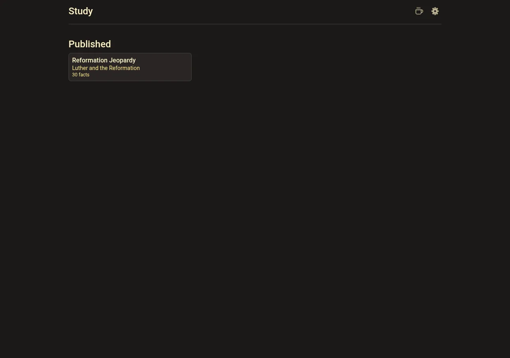

# Study

Study turns a set of facts into flashcards, without ever storing a
front/back pair: a fact is one true thing, stored once as named slots, and
each **question** is a declaration of which slot is the answer and which
others are shown beside it. The same fact can be asked a dozen different
ways without repeating any of its data — one set of 22 facts asks 62
different questions.

Play a set as [the drill](features.md#the-drill), a plain pass through the
queue, or, once enough of its facts are tagged for it, as
[the board](features.md#the-board), a points grid. Every answer moves that
question's own difficulty rating, which is what decides where it lands on
the board and how often it resurfaces in the drill — there is deliberately
no rating of the player.

- [Features](features.md): what each mode does, and who may use it.
- [Contributing](contributing.md): running it locally, the architecture, the
  checks it must pass.
- [History](history.md): the rewrite that split a card into a fact and a
  question, and the route that grew on the same bundle.
- [Trivia](trivia.md)

## Trivia

The app's first commit is also its biggest: a 7,166-line scaffold copied
from the platform's own template
([history](history.md#a-scaffold-then-a-rewrite-august-2026)).
